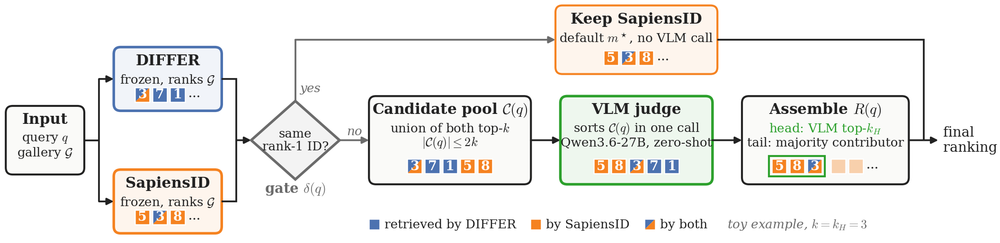
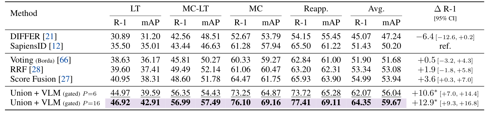
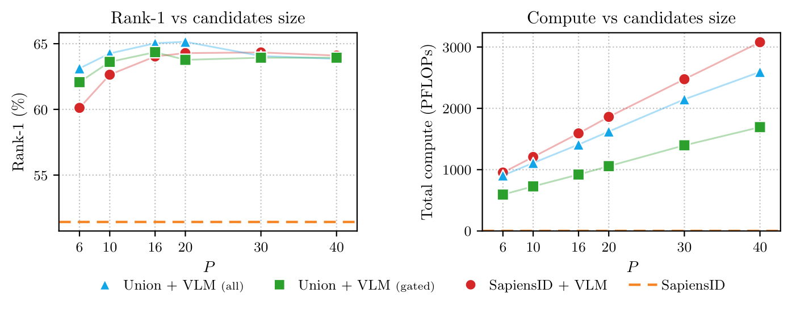
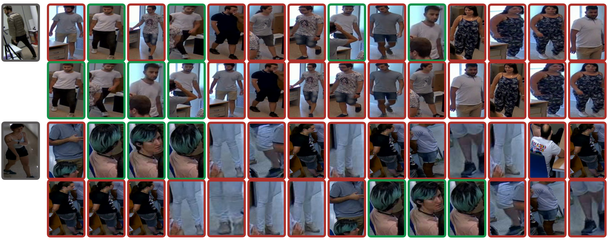

# JudgeReID

Code for **[VLM-as-a-Judge for Person Re-Identification](https://arxiv.org/abs/2611.03027)**
(NeurIPS 2026 Workshop, VLM4RWD).

<a href='https://huggingface.co/papers/2611.03027'></a>
[](https://arxiv.org/abs/2611.03027)
[](https://bdager.github.io/CHIRLA/leaderboard.html)

<p align="center">
  
</p>

Two frozen Re-ID experts, [DIFFER](https://github.com/xliangp/DIFFER) and
[SapiensID](https://github.com/mk-minchul/sapiensid), each rank the gallery. When they
agree on the rank-1 identity, their ranking is kept. When they disagree, the union of
their top-k candidates is shown to a general-purpose VLM
([Qwen3.6-27B](https://huggingface.co/Qwen/Qwen3.6-27B), zero-shot), which sorts the
candidates by how likely each is the query person. Nothing is fine-tuned on the target
data.

## Results on CHIRLA Dataset

<p align="center">
  
</p>

_Rank-1 and mAP (%), averaged over the CHIRLA train/test subset pairs. P is the size of
the candidate pool the VLM sees (k = P/2 per expert). Δ R-1 is the average rank-1 gain
over SapiensID with its 95% CI from a paired bootstrap over identities; \* marks
p < 0.05 under an exact sign-flip test._

The gate sends the VLM only the queries where the experts disagree, which removes about
40% of the calls:

<p align="center">
  
</p>

_Average rank-1 over the four scenarios (left) and total compute to run all four once
(right), as the pool size P grows. All pipelines sit well above SapiensID alone (dashed).
The gated pipeline reaches the same accuracy range at a fraction of the compute._

<p align="center">
  
</p>

_Two gated queries (query in gray; green is a correct identity, red an incorrect one).
For each query, the upper row is the merged pool in the order shown to the judge and the
lower row is the order the judge returns. Above, the judge lifts four correct candidates
to the head. Below, a failure case: it demotes the three correct ones._

## Repository layout

```
JudgeReID/
├── create_embeddings.py     # expert embeddings for a CHIRLA split → .h5
├── eval_vlm_rerank.py       # VLM judge over a candidate CSV
├── measure_flops.py         # per-image FLOPs / latency of the experts
├── run_vllm_server.sh       # launches vLLM from configs/vlm/<name>.yaml
├── scripts/                 # run_all.sh / run_scenario.sh: the full pipeline
├── configs/
│   ├── config.yaml          # retries, concurrency, image-label settings
│   └── vlm/                 # Qwen3.6-27B (main) and Qwen3.6-35B-A3B
├── ensemble/
│   ├── top1_agreement.py    # the gate: queries where both experts agree at rank 1
│   ├── remove_matching_queries.py
│   ├── merge_topk.py        # union of the experts' top-k
│   ├── build_final_results.py  # final ranking + CMC / mAP
│   └── ensemble.py          # Borda, RRF and score-fusion baselines
├── models/                  # DIFFER and SapiensID are cloned here (see Setup)
├── assets/                  # README figures
├── metrics/                 # CMC@k / mAP (evaluate_reid.py is the CHIRLA benchmark's)
├── reasoning/               # VLM client, prompts (and their ablation variants), response parsing
└── docs/                    # step-by-step reproduction, how compute is measured
```

## Setup

### 1. Python environment

Tested with Python 3.12 and CUDA 12.8.

```bash
git clone https://github.com/bdager/JudgeReID.git && cd JudgeReID
python -m venv .venv && source .venv/bin/activate
pip install -r requirements.txt   # edit the --index-url line for another CUDA version
```

vLLM goes in a **separate** environment, since it pins its own PyTorch. The paper used
vLLM `0.17.0rc1.dev116`. A later release that supports Qwen3.6 should also work.

```bash
python -m venv .venv-vllm && .venv-vllm/bin/pip install vllm
```

### 2. Expert models

DIFFER and SapiensID are not vendored. Clone them into `models/` at the commits we used:

```bash
git clone https://github.com/xliangp/DIFFER.git models/DIFFER
git -C models/DIFFER checkout 67acb5d3658d103b4412c8c99f93ee8f085802fe

git clone https://github.com/mk-minchul/sapiensid.git models/sapiensid
git -C models/sapiensid checkout a8d8011117db23f20c7ade3bc38e8075810ac886
```

> ⚠️ SapiensID crashes on crops where no person is detected. Apply this one-line fix after cloning:
> ```bash
> sed -i 's/len(_keypoints\[0\]) > 0/len(_keypoints) > 0/' models/sapiensid/tasks/sapiensID/src/aligners/keypoint_predictor/__init__.py
> ```

`create_embeddings.py` and `metrics/evaluate_reid.py` are the ones from the
[CHIRLA benchmark](https://github.com/bdager/CHIRLA/tree/main/benchmark/reid), which supports
these two experts.

### 3. Checkpoints

| Model                 | Source                                                                                      | Place under                                                                |
| --------------------- | ------------------------------------------------------------------------------------------- | -------------------------------------------------------------------------- |
| DIFFER, `Celeb_light` | [DIFFER weights](https://drive.google.com/drive/folders/1RzAhSeSOgL2u8130mFAMdHI2k4sX9dQD)  | `checkpoints/DIFFER/Models/Celeb_light/{config.yml, eva02_l_bio_best.pth}` |
| SapiensID, `wb12m`    | [SapiensID weights](https://drive.google.com/file/d/18d8Ogw60zxnaIIjSb99Y8oLvzCEn_L-Z/view) | `checkpoints/SapiensID/sapiensid_wb12m/{model.yaml, model.pth}`            |
| YOLOv8n-pose          | Ultralytics (command below)                                                                 | `~/.cache/yolov8n-pose.pt`                                                 |

SapiensID's aligner loads the pose detector from the fixed path `~/.cache/yolov8n-pose.pt`:

```bash
python -c "from ultralytics import YOLO; YOLO('yolov8n-pose.pt')" && mv yolov8n-pose.pt ~/.cache/
```

The VLM weights are downloaded from the Hugging Face Hub the first time the server starts.

### 4. CHIRLA Dataset

Download the dataset from the [Hugging Face Hub](https://huggingface.co/datasets/bdager/CHIRLA)
(see [bdager/CHIRLA](https://github.com/bdager/CHIRLA) for details):

```bash
git lfs install
git clone https://huggingface.co/datasets/bdager/CHIRLA /path/to/CHIRLA
```

The code expects `$CHIRLA_ROOT/benchmark/reid/...` (images) and
`$CHIRLA_ROOT/metadata/reid_<scenario>_{gallery,query}.csv` (splits).

### 5. Paths

```bash
cp .env.example .env   # then set CHIRLA_ROOT and EXPERIMENTS_ROOT
```

Python scripts read `.env` on their own. In a shell, load it with
`set -a; source .env; set +a`. If the vLLM server runs on another machine, set `VLM_HOST`.

## Reproducing the paper

Start the VLM server (Qwen3.6-27B, tensor-parallel over 2 GPUs; the paper used two NVIDIA
L40S) in the vLLM environment:

```bash
bash run_vllm_server.sh qwen3.6-27b --gpus 0,1
```

Then one command runs the whole pipeline on the four scenarios at the paper's main
setting (P=16) and prints the results table:

```bash
bash scripts/run_all.sh                       # K=3 bash scripts/run_all.sh for P=6
bash scripts/run_scenario.sh long_term        # a single scenario
```

[docs/reproduce.md](docs/reproduce.md) lists the individual steps these scripts run, and
the commands for the ensemble baselines, the prompt ablations and the compute measurements.

## License

The code is released under the [MIT License](LICENSE). The models and the CHIRLA dataset
have their own licenses; note that SapiensID is non-commercial (CC BY-NC 4.0).

## Acknowledgements

The Re-ID metrics and embedding script are adapted from the
[CHIRLA benchmark](https://github.com/bdager/CHIRLA). We thank the authors of
[DIFFER](https://github.com/xliangp/DIFFER) and
[SapiensID](https://github.com/mk-minchul/sapiensid) for releasing their code and weights.

## Citation

```bibtex
@misc{dominguezdager2026judgereid,
  title         = {{VLM}-as-a-Judge for Person Re-Identification},
  author        = {Dominguez-Dager, Bessie and Cazorla, Miguel and Lepetit, Vincent},
  year          = {2026},
  eprint        = {2611.03027},
  archivePrefix = {arXiv},
  primaryClass  = {cs.CV},
  note          = {NeurIPS 2026 Workshop VLM4RWD}
}

@article{dominguez2026chirla,
  title   = {{CHIRLA}: Comprehensive High-resolution Identification and Re-identification for Large-scale Analysis},
  author  = {Dominguez-Dager, Bessie and Escalona, Felix and Gomez-Donoso, Francisco and Cazorla, Miguel},
  journal = {Scientific Data},
  volume  = {13},
  number  = {109},
  year    = {2026},
  doi     = {10.1038/s41597-025-06425-3}
}
```
